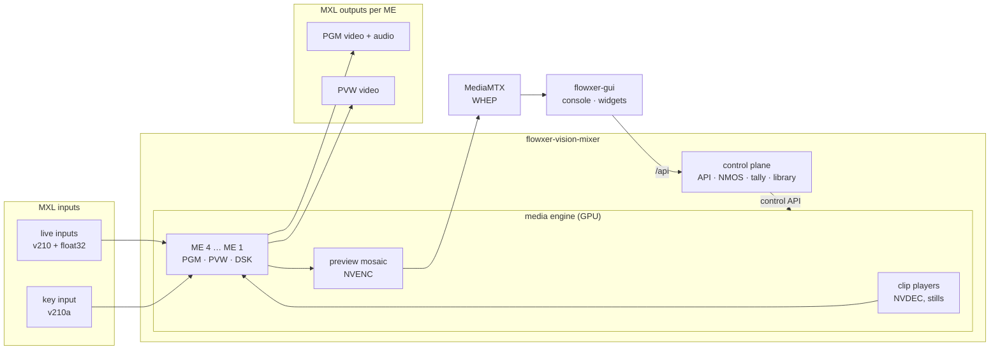

# FlowXer

DMF **Vision Mixer** microservice for the [EBU Dynamic Media Facility](https://tech.ebu.ch/dmf/ra) Media eXchange Layer ([dmf-mxl/mxl](https://github.com/dmf-mxl/mxl)).

The mixer is controlled over HTTP. OpenAPI lives at `/docs` on the **GUI origin** (port **9620**). Media stays **uncompressed** on the MXL domain:

| Essence | MXL media type |
|---------|----------------|
| Video | `video/v210` (10-bit 4:2:2) |
| Key (fill + key) | `video/v210a` |
| Audio | `audio/float32`, 48 kHz |

Two images: **`flowxer-vision-mixer`** holds the Python control plane (FastAPI: API, state, NMOS, tally, media library) and the C++/CUDA **media engine** (`engine/`), which the control plane starts as a child process, restarts with a backoff and drives over a control API on 127.0.0.1. **`flowxer-gui`** (React, nginx) is the operator console and serves the operator-screen widgets. An NVIDIA GPU is required.



## What it does

- **MEs:** up to 4 (`FLOWXER_PANELS`), every rendering ME renders all the time on the TAI grid: PGM video + PGM audio and PVW video per ME, written to MXL. An ME can take the Program of a higher ME (re-entry, the same output frame).
- **Sources** in slot order: live inputs (an MXL video + audio pair, routed over IS-05), clip players, Black.
- **Clip players** play clips from the media library (decoded on the GPU) and stills (frame memory): loop, play on cut, cue, play, pause, stop. The colour bars ship as a library still.
- **Transitions:** Cut, Fade (mix), Fade to Black. **Audio follows video** with an equal-power crossfade. Stingers and wipe patterns come back in P3: until then a stinger take is a cut.
- **DSK 1** on ME 1 keys a v210a fill + key flow (e.g. mxl-browser-source in `v210a` key mode) over ME 1 Program: on, off, auto. Keys have no preview: Preview shows only its source.
- **Preview mosaic:** the engine encodes every source and every ME's Program and Preview once (NVENC); the console crops its pictures out of that one WebRTC stream. No audio preview.
- **NMOS** IS-04/IS-05 node (BCP-007-03), **tally** over TSL UMD 5.0 (to receivers, and the raw tally for the platform's tally calculator), Prometheus metrics.
- Runs in **Docker** (`vision-mixer` + `gui`) or on Kubernetes with the MXL domains mounted.

## Operator GUI

The GUI is a **separate React service** (Vite + TypeScript). Every control on the console is an HTTP call to the mixer API; there is no GUI-only mixer path.

```
┌─ File  Settings  Tally  Help ─────────────── [CPU% RAM% format] ─┐
│  [ME 1] [ME 2]                                                   │
│  PREVIEW                       PROGRAM                           │
│  [DSK 1 ON|AUTO|25 f]  Stinger ⚙                                 │
│                                                                  │
│  [Cam 1 ⚙] [Cam 2 ⚙] [Clip 1 ⚙] …   source tiles (16:9 or 9:16)  │
│   left of picture = PVW · right = PGM          Cut     Fade      │
│   clip players: [item ▾] · 00:03.12 −00:06.37 · ⏮ ▶ ⏸ ■ LOOP AUTO │
│                                                Fade to Black Wipe │
└──────────────────────────────────────────────────────────────────┘
```

- **Pictures:** every source tile and the Preview and Program monitors are crops of the engine's one preview mosaic: the page opens **one WHEP session** (`GET /api/v1/preview` gives the stream and the tile map) and reconnects by itself when it drops. Each picture is a box of its tile's aspect ratio with `overflow: hidden`, holding a `<video>` on that one stream that a CSS `transform: scale(…) translate(…)` stretches and moves so only the tile shows. That works in every browser (no `object-view-box`). Black has no tile; off-air the monitors say why there is no picture.
- **Clip players** pick the library clip or still they play in their tile's header (an empty player is black), show the position and remaining time over the picture, and have the transport under it: ⏮ cue the first frame, ▶ play, ⏸ pause, ■ stop (back to the first frame), **LOOP**, **AUTO** (play on cut: start when taken to Program). A still shows **FRAME MEM**.
- **DSK** (per keyer): ON/OFF cuts it, **AUTO** fades it over its rate (in frames; kept with the keyer), `· NO KEY` when its key input has no signal.
- **File** takes the mixer on-air or off-air and opens the **clip and still library** and the stinger library.
- **Settings → Console layout…** (`PUT /workspace`): video format (off-air), source tiles 16:9 or 9:16 (display only, also on air), the number of sources, MEs, stinger slots and keyers. What the production sets through the environment is greyed out.
- The gear on a **source** (`PATCH /inputs/{id}`): name, kind (`mxl_live`, `clip_player`, `black`), flows of a live input, the clip or still of a clip player with loop and play on cut, and the auto-stinger.
- **Cut / Fade / Fade to Black / Wipe** map to `/mixer/cut`, `/mixer/fade`, `/mixer/fade-to-black`, `/mixer/wipe`.
- **Tally → Receivers…** adds TSL UMD 5.0 listeners (Companion, VSM, BFE, Riedel HI, custom).
- The **status chip** is a CPU / RAM / format pill; click it for the mixer state, NMOS, load and issues.

```bash
cd gui && npm install && npm run dev   # proxies /api, /docs, /openapi.json, /widgets to the mixer on loopback :9610
```

### Widgets

Operator screens (the platform's production designer) frame single controls of FlowXer. flowxer-gui serves them:

| Widget | Query | Minimum size | Shows |
|---|---|---|---|
| `bus` | `me` (required, 1..number of MEs) | 480×150 | that ME's Program and Preview rows (the inputs and the Programs of the higher MEs) with Cut and Auto; tally colours |

- `GET /widgets` lists them with a JSON schema of their parameters (from the mixer's `GET /api/v1/widgets`); it answers an `Origin` that `WIDGET_FRAME_ANCESTORS` names (or `*`) with `Access-Control-Allow-Origin`.
- `GET /widget/bus?me=<n>[&theme=dark|light|transparent]` is the page without the console around it, on the GUI's own origin (its `/api`). A bad parameter answers 400, an unknown widget 404. Only these routes carry `Content-Security-Policy: frame-ancestors <WIDGET_FRAME_ANCESTORS>`; none carries `X-Frame-Options`. The page posts `{type: "widget-ready"}` and `{type: "widget-size", w, h}` to its parent.
- `WIDGET_FRAME_ANCESTORS` is set on the **gui** container: a CSP source list, default `'self'` (an invalid value stops nginx with exit code 78).

## API

Compose and the platform publish **one** HTTP port: the operator GUI on **9620**. nginx there proxies `/api`, `/docs`, `/redoc` and `/openapi.json` to the mixer, which listens on **127.0.0.1:9610** (on the Docker network in bridge Compose), not on a public interface.

| | |
|--|--|
| Operator GUI | http://localhost:9620 |
| Swagger UI | http://localhost:9620/docs |
| Mixer API | http://localhost:9620/api/v1/… |
| Mixer on the host (loopback) | http://127.0.0.1:9610 |

If `FLOWXER_API_TOKEN` is set, calls to **9610** need `Authorization: Bearer …` or `X-FlowXer-Token`. Calls through **9620** do not: nginx (and the Vite dev proxy) inject the token. `/api/v1/health` stays unauthenticated on both.

| Console action | API |
|----------------|-----|
| Poll layout, buses, resources, preview map, clip player state | `GET /console` |
| File → mixer on-air / off-air | `POST /mixer/start`, `POST /mixer/stop` |
| Settings → Console layout… | `PUT /workspace` |
| Source left click (PVW) / right click (PGM) | `POST /mixer/preview`, `POST /mixer/take` |
| Source ⚙, clip player item, loop, play on cut | `PATCH /inputs/{id}` (`library_item_id`, `loop`, `play_on_cut`, `stinger_slot_id`) |
| Clip player transport | `POST /players/{id}/cue` (`{"frame": n}`), `/play`, `/pause`, `/stop` |
| DSK ON/OFF, rate | `PATCH /keyers/{id}` (`enabled`, `rate_ms`) |
| DSK AUTO | `POST /keyers/{id}/auto` (`duration_ms`, default the keyer's rate) |
| Cut / Fade / Fade to Black / Wipe | `POST /mixer/cut`, `/fade`, `/fade-to-black`, `/wipe` |
| Stinger chip / ⚙ | `POST /stinger/play`, `PATCH /stinger-slots/{id}` |
| File → libraries | `GET /library`, `POST /uploads`, `GET /jobs` |
| Tally → Receivers… | `PUT /tally/receivers`, `POST /tally/refresh` |
| Pictures | `GET /preview`: the mosaic's WHEP URL (or the port of the built-in MediaMTX) and the tile map (`source:<input id>`, `panel:<panel id>:pgm\|pvw`) |
| Widgets | `GET /widgets` (gui) = `GET /api/v1/widgets` |
| NMOS (IS-04/IS-05) | Node API on **3252**, see [docs/nmos.md](docs/nmos.md) |

API only: `GET /health`, `/config`, `/engine` (the engine's status: GPU time per stage, output counters, arrival lag per input and the recommended latency, clip players, keyers; refreshed once a second), `/mixer`, `/domain`, `/domain/flows`, `/metrics`, `/livez`, `/readyz`; `GET /config/export`, `POST /config/import`; `POST`/`DELETE /inputs`; `GET /storage/clips`, `/storage/stingers`; the library's item, upload and job routes (see [Media library](#media-library)).

```bash
curl http://localhost:9620/api/v1/health
curl -X POST http://localhost:9620/api/v1/mixer/start -H 'content-type: application/json' -d '{"program_input_id":"cam-1"}'

# A clip from the library on clip player 1, looping, started by the Cut that takes it to Program
curl -X PATCH http://localhost:9620/api/v1/inputs/clip-1 -H 'content-type: application/json' \
  -d '{"library_item_id":"<item id>","loop":true,"play_on_cut":true}'
curl -X POST http://localhost:9620/api/v1/mixer/preview -H 'content-type: application/json' -d '{"input_id":"clip-1","panel_id":"me-1"}'
curl -X POST http://localhost:9620/api/v1/mixer/cut -H 'content-type: application/json' -d '{"panel_id":"me-1"}'
curl -X POST http://localhost:9620/api/v1/players/clip-1/pause

# Re-entry: ME 1 takes ME 2's Program
curl -X POST http://localhost:9620/api/v1/mixer/take -H 'content-type: application/json' \
  -d '{"input_id":"me-2","panel_id":"me-1","transition":"cut"}'

# DSK 1: rate 25 frames at 50p, then fade it on
curl -X PATCH http://localhost:9620/api/v1/keyers/dsk-1 -H 'content-type: application/json' -d '{"rate_ms":500}'
curl -X POST http://localhost:9620/api/v1/keyers/dsk-1/auto

# TSL 5.0 tally/UMD to Riedel HI (same shape for Companion, VSM, BFE)
curl -X PUT http://localhost:9620/api/v1/tally/receivers -H 'content-type: application/json' \
  -d '{"receivers":[{"id":"hi-1","kind":"hi","label":"Riedel HI","host":"10.0.0.40","port":8900,"transport":"udp","enabled":true,"screen":0,"index_offset":0}]}'
```

## Docker

Compose pulls the images published from `main` to GHCR (`latest`, or set `FLOWXER_IMAGE_TAG`). The mixer needs an NVIDIA GPU and the NVIDIA container toolkit (Compose reserves one GPU).

```bash
mkdir -p storage/clips storage/library storage/import
# optional: drop clips and pictures into storage/import for watched ingest
docker compose pull
docker compose up
```

Images: `ghcr.io/firesh0ot/flowxer-vision-mixer` and `ghcr.io/firesh0ot/flowxer-gui`, tagged `{version}`, `latest` and `git-<sha>`. Both run as **uid/gid 1000**; host mounts (`/Volumes/mxl`, `./storage`) must be writable by that user. To run a source tree, `docker build` the two Dockerfiles yourself (`Dockerfile`, `gui/Dockerfile`).

- **gui** on **9620**: console, widgets, mixer API (`/api/v1`) and OpenAPI. Upstream `FLOWXER_MIXER_URL` (Compose `http://vision-mixer:9610`; host network and Kubernetes `http://127.0.0.1:9610`).
- **vision-mixer** on **127.0.0.1:9610**, and the preview mosaic of the engine's built-in MediaMTX: WHEP 8989, HLS 8988, ICE 8289 (UDP and TCP). `FLOWXER_HOST` defaults to `127.0.0.1`; bridge Compose sets `0.0.0.0` so the GUI container can reach it.
- A tmpfs MXL domain at `/mxl-domain` (the deprecated single-domain alias `FLOWXER_MXL_DOMAIN`, for local demos) and `./storage` for the library.

The mixer image is CUDA 12.8 on Ubuntu 24.04 with [MXL](https://github.com/dmf-mxl/mxl) `release/v1.1` at `218ddaa0a08c12ffe75fc475ae65aa3d9eef16d7` (image label `io.dmf.mxl.revision`, `GET /api/v1/health` `mxl_revision`), Ubuntu's FFmpeg (the engine's NVDEC and NVENC, the library's conversions) and MediaMTX. The engine's own README is [engine/README.md](engine/README.md); `flowxer-engine --selftest` checks the GPU kernels against the CPU reference.

## Running on an MXL platform

On an MXL node, FlowXer is one NMOS media function: GUI **9620**, mixer **9610** (loopback), Node API **3252**. `FLOWXER_API_TOKEN` is **required**. The pod needs one GPU (nvidia runtime class, a time-sliced share is enough), `NVIDIA_DRIVER_CAPABILITIES=compute,video,utility` (the image sets it), the MXL root, `/config` for the state and a persistent volume for the library (`FLOWXER_STORAGE_ROOT`).

```bash
kubectl apply -f deploy/kubernetes/flowxer.yaml               # host network
kubectl apply -f deploy/kubernetes/servicemonitor.yaml        # optional, Prometheus Operator CRDs
```

`deploy/kubernetes/flowxer-pod-network.yaml` is the same function on the pod network with the platform's env names (`MXL_*`, `NMOS_*`, `SHUTDOWN_TIMEOUT_S`, `PREVIEW_*`): the node announces the pod IP, probes go to `/livez` and `/readyz`, the preview mosaic goes to the platform's shared MediaMTX. Host Compose: `docker compose -f docker-compose.host.yml up` with `/Volumes/mxl` mounted and `FLOWXER_API_TOKEN` set.

### Ports

| Port | Use |
|---|---|
| 9610 | Mixer HTTP (`/api/v1`, `/metrics`, `/livez`, `/readyz`), bind `127.0.0.1` |
| 9620 | Operator GUI and widgets (proxies `/api` to the mixer) |
| 3252 | NMOS Node + Connection API (not behind the API token); 3253 reserved |
| 9630 | The media engine's control API, `127.0.0.1` only (`FLOWXER_ENGINE_PORT`) |
| 8989, 8988, 8289 udp+tcp | The built-in MediaMTX: WHEP, HLS, ICE (not used with `PREVIEW_PUBLISH_URL`) |
| 8654, 9897 | The built-in MediaMTX: RTSP ingest and API, `127.0.0.1` only |

### Configuration

Settings come from the environment (or a `.env` file). Where a platform name exists it wins over the `FLOWXER_` name; both work. An invalid value stops the process with exit code 78.

| Variable | Default | Notes |
|---|---|---|
| `FLOWXER_HOST`, `FLOWXER_PORT` | `127.0.0.1`, `9610` | Mixer bind. Bridge Compose uses `0.0.0.0` |
| `FLOWXER_MIXER_URL`, `FLOWXER_GUI_PORT` | `http://127.0.0.1:9610`, `9620` | gui container: nginx upstream and port |
| `WIDGET_FRAME_ANCESTORS` | `'self'` | gui container: who may frame the widgets, see [Widgets](#widgets) |
| `MXL_DOMAIN_SCAN_PATH` / `FLOWXER_MXL_ROOT` | `/Volumes/mxl` | Scan for `domain_def.json` |
| `MXL_OUTPUT_DOMAIN_DIR` / `FLOWXER_MXL_OUTPUT_DOMAIN_DIR` | `<root>/flowxer-<seed-short>` | Output domain of the MEs; never `mirror-*`. An existing `domain_def.json` with another id is logged as an error and kept |
| `MXL_OUTPUT_DOMAIN_ID` / `FLOWXER_MXL_OUTPUT_DOMAIN_ID` | UUIDv5(seed) | |
| `MXL_HISTORY_DURATION` / `FLOWXER_MXL_HISTORY_DURATION_NS` | `200000000` | ns; written to `options.json` when the domain is created |
| `MXL_CLEANUP_ON_EXIT` / `FLOWXER_MXL_CLEANUP_ON_EXIT` | `false` | Remove the own output domain on SIGTERM (only when its id matches; never the root or a mirror) |
| `FLOWXER_NMOS_ENABLE` | `true` | `false` keeps REST-only behaviour |
| `NMOS_SEED` / `FLOWXER_NMOS_SEED` | `{hostname}-flowxer` | Stable UUIDv5 ids |
| `NMOS_LABEL` / `FLOWXER_NMOS_LABEL`, `NMOS_TAGS` / `FLOWXER_NMOS_TAGS` | `FLOWXER_TITLE`, `{}` | Node and device label and tags |
| `NMOS_PORT` / `FLOWXER_NMOS_PORT` | `3252` | |
| `NMOS_HOST_ADDRESS` / `FLOWXER_NMOS_HOST_IP` | first non-loopback | Node `href` / `api.endpoints` (an IP address) |
| `NMOS_REGISTRY_ADDRESS`, `NMOS_REGISTRY_PORT` | empty | Registration API; or the full URL in `FLOWXER_NMOS_REGISTRY_URL` |
| `NMOS_DNS_SD` / `FLOWXER_NMOS_DNS_SD` | `false` | Not implemented; `true` only logs a warning |
| `FLOWXER_STATE_DIR` | `/config` | Saved state, see below |
| `FLOWXER_FORMAT`, `FLOWXER_LIVE_INPUTS`, `FLOWXER_INPUT_LABELS`, `FLOWXER_CLIP_PLAYERS`, `FLOWXER_PANELS` | empty | The production's structure, see below |
| `FLOWXER_RENDER_MES` | all MEs | The first n MEs render (PGM, PVW, senders and flows) |
| `FLOWXER_PVW_OUTPUTS` | `true` | PVW video flows; `false` renders PVW for the previews only (saves PCIe) |
| `FLOWXER_LATENCY` | `4` | Grains (1–10): output grain *i* is made from input grain *i − L*. It must cover how late the inputs arrive: `GET /api/v1/engine` gives each input's arrival lag and `recommended_latency_grains` |
| `FLOWXER_PROGRAM_AUTOSTART` | `false` | Start Program at process start (after the state is restored) |
| `FLOWXER_TALLY_TSL` | empty | Raw tally for the platform's tally calculator, see [Raw tally export](#raw-tally-export-flowxer_tally_tsl) |
| `PREVIEW_PUBLISH_URL`, `PREVIEW_PATH_PREFIX`, `PREVIEW_WHEP_URL`, `PREVIEW_HLS_URL` | empty, `flowxer` | The platform's preview contract: publish the mosaic (`<prefix>/mosaic`) to a shared MediaMTX over RTSP; the console plays it from `PREVIEW_WHEP_URL`. Empty: the built-in MediaMTX |
| `MEDIAMTX_PUBLIC_IP` | empty | Built-in MediaMTX: extra ICE host candidate for browsers |
| `FLOWXER_ENGINE_PORT`, `FLOWXER_ENGINE_GPU`, `FLOWXER_ENGINE_BIN` | `9630`, `0`, `flowxer-engine` | The engine's control port (loopback), CUDA device in the container, binary |
| `FLOWXER_STORAGE_ROOT`, `FLOWXER_LIBRARY_DIR`, `FLOWXER_IMPORT_DIR` | `./storage` (image `/storage`), `<root>/library`, empty | Media library, see below |
| `FLOWXER_CONVERT_CONCURRENCY`, `FLOWXER_UPLOAD_LIMIT_GB` | `1`, `20` | |
| `SHUTDOWN_TIMEOUT_S` / `FLOWXER_SHUTDOWN_TIMEOUT_S` | `10` | Open requests get half; the rest is for stopping media and deregistering |
| `FLOWXER_API_TOKEN` | empty | **Required on the platform** |
| `FLOWXER_SIMULATE` | `false` | The control plane without the engine (tests, the AMWA testing tool): state, NMOS and tally work, no media |

### The media engine

The engine reads the live inputs from MXL (one DMA upload per grain), plays the clip players, renders every ME on the GPU (ME 4 → ME 1, so re-entry is the same output frame), keys DSK 1, packs PGM and PVW to v210 and writes them with the PGM audio to MXL at a fixed latency on the TAI grid: when it is late it skips to the current grain and counts it; it never slides. It encodes the preview mosaic once with NVENC. [engine/README.md](engine/README.md) has the design, its configuration, its API and the lab measurements (P1: 4 MEs, 8 inputs and the mosaic at 3.4 ms GPU render time per grain and 0.13 CPU cores on an A16).

FlowXer writes the engine's configuration (`FLOWXER_ENGINE_*`) itself, starts it with the GPU of the container, and after every start pushes the routes, clip players, keyers and buses. An engine that exits is started again after 1, 2, 5, then every 10 s; `GET /api/v1/health` (`engine`) and `GET /api/v1/engine` show its state. A crashed engine's MediaMTX is reaped by tini (PID 1).

GPU memory: about 0.6 GiB for 1 ME up to 0.8 GiB for 4 MEs with 8 inputs and the mosaic, about 50 MB per clip player and 170 MB per loaded clip (lab: 867 MiB with 2 MEs, 4 inputs, a clip and a still, 1 key input and the mosaic).

### Saved state, export and import

The mixer saves its configuration to `FLOWXER_STATE_DIR/state.json` after every successful change through the API and after every IS-05 activation, and loads it on start: inputs, console layout, mixer panels, downstream keyers, stinger slots, tally receivers and the receiver connections. Mount `/config` to keep it across restarts. A file that cannot be read is logged and ignored (the mixer starts with defaults).

`GET /api/v1/config/export` returns the same document; `POST /api/v1/config/import` restores it (409 while the mixer is on-air, 422 when it is invalid). It holds no secrets: the API token only comes from the environment.

### Production structure from the environment

The platform's production designer sets the mixer's structure through the environment, so the inputs and the NMOS labels are known before the pod starts. A variable that is set wins over the saved state at every start; unset (or empty), the saved state and the GUI decide.

| Variables | Set | Example |
|---|---|---|
| `FLOWXER_FORMAT` | `format_id`, raster and rate | `1080p50` |
| `FLOWXER_LIVE_INPUTS`, `FLOWXER_INPUT_LABELS`, `FLOWXER_CLIP_PLAYERS` | The input list: `logical_source_count` and each input's id, kind and label | `4`; `["Cam 1","Cam 2","Cam 3","Cam 4"]` or `Cam 1,Cam 2,Cam 3,Cam 4`; `2` |
| `FLOWXER_PANELS` | `mixer_panel_count` (MEs, 1–4) | `2` |

With the input list set, the inputs are in this order (the slot order, the TSL INDEX): `cam-1`..`cam-N` (`mxl_live`, labelled from `FLOWXER_INPUT_LABELS`, the rest `Camera n`), `clip-1`..`clip-C` (clip players, `Clip n`), then `black` (Black). Live inputs and clip players together are at most 23 (24 sources with Black). More labels than live inputs, a duplicate or empty label, or an unknown format stop the process with exit code 78. `FLOWXER_CLIP_PLAYERS` replaces `FLOWXER_TEST_SOURCES`, which is no longer read; saved states and API clients with test, file or replay inputs get clip players.

- **Kept from the saved state:** receiver connections (IS-05), and per input the essences, group hint, library item, loop, play on cut and auto-stinger when its id and kind stay the same; keyers, stingers, tally and the other workspace fields. Routes of an input the environment removed are dropped; Program or Preview on it starts empty.
- **API and GUI:** what the environment sets cannot be changed (409, the message names the variable): `PUT /workspace` with another `format_id`, `logical_source_count` or `mixer_panel_count`; `POST` and `DELETE /inputs`; `PATCH /inputs/{id}` with another `label` or `kind`. The current values pass, so a client may send whole documents. `GET /console` lists these fields in `pinned`; the GUI greys them out.
- **Export and import:** an imported document gets the environment's structure, as at a start; everything else in it is imported.
- **NMOS labels** follow the structure: receivers `<input label> Video` and `<input label> Audio` for each live input and `DSK 1 Key` (v210a) for the keyer; per rendering ME the senders `ME <n> PGM Video`, `ME <n> PGM Audio` and `ME <n> PVW Video`, each with its own flow. ME 1 PGM keeps FlowXer's flow ids across versions.
- `FLOWXER_PROGRAM_AUTOSTART=true` starts Program once the state is restored: ME 1 Program on the first live input (else the first input), Preview on the next one. A start that fails is logged and shown in `GET /mixer`, and tried again after 2, 5, 10, then every 30 s until Program runs or an operator starts or stops it. An input routed to an MXL domain that does not exist yet (a fabrics mirror after a node reboot) is black and silent and reads its flow once the domain appears.

```bash
FLOWXER_FORMAT=1080p50
FLOWXER_LIVE_INPUTS=4
FLOWXER_INPUT_LABELS='["Camera 1","Camera 2","Camera 3","Camera 4"]'
FLOWXER_CLIP_PLAYERS=2
FLOWXER_PANELS=2
FLOWXER_PROGRAM_AUTOSTART=true
```

### Exit codes and probes

| Code | Meaning |
|---|---|
| 1 | Start-up failed (see the log) |
| 75 | The mixer or NMOS port cannot be bound |
| 78 | Invalid configuration (the message names the setting) or an unusable output domain |
| 143 | Stopped by SIGTERM: media stopped, node deregistered, own domain removed with `MXL_CLEANUP_ON_EXIT` |

`/readyz` is 200 only when the MXL root is readable, the output domain is writable and, with a registry configured, the node is registered (heartbeat within 12 s). `/livez` is 503 when the control plane is stuck: an IS-05 activation or a Program start or stop has not finished for 60 s (Kubernetes then restarts the pod); `flowxer_control_plane_busy_seconds` is the age of the oldest running one.

### Metrics

`GET /metrics` (and `/api/v1/metrics`, not behind the API token) is Prometheus text. For dashboards:

| What | Metrics |
|---|---|
| On air, Program | `flowxer_on_air`, `flowxer_program_stalled`, `flowxer_frames_rendered_total`, `flowxer_frames_dropped_total` (grains skipped to stay on the TAI grid), `flowxer_transitions_total{type}`, `flowxer_program_input`, `flowxer_preview_input` |
| Engine output | `flowxer_engine_up`, `flowxer_engine_restarts_total`, `flowxer_engine_output_fps`, `flowxer_engine_output_grains_rendered_total`, `_committed_total`, `_skipped_total`, `_late_total`, `flowxer_engine_output_write_failed_total`, `flowxer_engine_output_lag_grains{stat}`, `flowxer_engine_output_commit_ms{stat}` |
| Latency | `flowxer_latency_grains`, `flowxer_recommended_latency_grains` (covers the latest arrival seen) |
| Inputs (FlowXer ids) | `flowxer_input_arrival_ms{input,essence,stat}`, `flowxer_input_late_total{input}`, `flowxer_input_missing_total{input,essence}`, `flowxer_input_state{input,essence,state}` |
| Inputs (engine names `in<n>`, `key<n>`) | `flowxer_engine_input_running`, `_grains_total`, `_late_total`, `_missing_total`, `_resyncs_total`, `_reopens_total`, `flowxer_engine_input_audio_blocks_total`, `_audio_missing_total`, `_audio_waits_total` |
| GPU time | `flowxer_engine_gpu_stage_ms{stage,stat}` with `stage` = `upload_per_input`, `unpack`, `me` (and `me="<n>"`, per ME), `pack`, `mosaic`, `render`, `download`, `total`; `flowxer_engine_gpu_utilization_percent`, `flowxer_engine_gpu_device_used_mb`, `flowxer_engine_gpu_engine_allocated_mb` |
| Clip players | `flowxer_engine_player_playing{player}`, `flowxer_engine_player_frames_decoded_total`, `flowxer_engine_player_frames_late_total`, `flowxer_engine_player_decode_ms{stat}` |
| Preview mosaic | `flowxer_engine_mosaic_frames_total`, `_dropped_total`, `flowxer_engine_mosaic_encode_ms`, `flowxer_engine_mosaic_connected` (publishing), `flowxer_engine_mosaic_bytes_total`, `flowxer_engine_gpu_encoder_sessions`, `flowxer_engine_gpu_encoder_percent`; own MediaMTX: `flowxer_engine_preview_mediamtx_running`, `_restarts_total` |
| Library | `flowxer_library_jobs{state=queued\|running}`, `flowxer_library_conversions_total{result}`, `flowxer_library_last_conversion_seconds`, `flowxer_library_nvenc` |
| Control plane | `flowxer_control_plane_busy_seconds`, `flowxer_nmos_registry_up`, `flowxer_nmos_activations_total{result}`, `flowxer_tally_export_*`, `flowxer_engine_cpu_percent{thread}`, `flowxer_process_cpu_percent`, `flowxer_process_memory_bytes` |

Gone with the GStreamer mixer: `flowxer_webrtc_peers`. The preview's viewers are the MediaMTX path's readers (MediaMTX API `/v3/paths/list`, or its own metrics). The Grafana dashboard `deploy/grafana/flowxer.json` shows the engine's fps, skipped and late grains and GPU time.

### Upgrading from FlowXer 14

The P2 image replaces 14.x in place with the same `/config` (the saved state), the same NMOS seed and the same output domain. Lab, from 14.21.46 with 4 live inputs routed over IS-05, 2 test sources, 2 MEs and a multiviewer reading ME 1 PGM: ME 1 PGM keeps its flow ids, the IS-05 activations of the live inputs are restored, their tally INDEX stays 0..N−1 and Black keeps its number; the multiviewer had no signal while the images were swapped and played again 3.2 s after the new one started.

- **Environment:** `FLOWXER_TEST_SOURCES` is no longer read: set `FLOWXER_CLIP_PLAYERS` instead (the designer's `testSources` becomes `clipPlayers`). Set a GPU (`nvidia.com/gpu`, `NVIDIA_DRIVER_CAPABILITIES=compute,video,utility`) and drop `FLOWXER_GPU`, `FLOWXER_GST_MODE`, `FLOWXER_MONITOR_FPS` and `FLOWXER_WEBRTC_*`. `WIDGET_FRAME_ANCESTORS` goes to the gui container.
- **What an operator loses:** test sources become clip players at the same TSL INDEX, empty (black) until a clip or the colour bars are put on them; the Replay input (the last INDEX) is gone, its role is a clip player's; the HTML overlay is gone, so DSK 1 stays on but keys nothing until a v210a key (e.g. mxl-browser-source in `v210a` mode) is routed to its receiver `DSK 1 Key`; 14.x showed the overlay on Preview too, P2 keys Program only (keys have no preview); stingers and Wipe are cuts until P3; the per-source WebRTC and JPEG previews are replaced by the mosaic; clips of the library are converted again (NVENC, about 35 s per minute of clip) and black until then.
- **New on the tally:** an ME's re-entry source, INDEX 1000 + n.
- **Known in 14.21.46:** started with its live inputs unrouted (autostart, or a start before the first IS-05 activation) its MXL sources crash the process (exit 139, a general protection fault in libstdc++ in an `mxlsrc` thread). With the routes in the saved state it starts. P2 has no such path.
- **Rollback** (not tested): 14.x does not know clip players and ignores a state that P2 saved (it starts from its environment and defaults). Keep the 14.x state (`GET /api/v1/config/export`, or a copy of `/config`) before the upgrade to roll back with it.

### Route a camera to input 1, take it to Program, route Program out

Live inputs have NMOS receivers; an IS-05 activation opens the engine's reader for that flow, a deactivation closes it. Replace the UUIDs with values from `GET http://<host>:3252/x-nmos/node/v1.3/receivers` and `…/senders`.

```bash
# The receivers of Camera 1 (video + audio).
curl -sS http://127.0.0.1:3252/x-nmos/node/v1.3/receivers

# Route an mxl-decklink sender onto Camera 1 video (the platform does this over IS-05).
# Accepted even if the flow is not on disk yet (state waiting).
curl -sS -X PATCH "http://127.0.0.1:3252/x-nmos/connection/v1.2/single/receivers/<RECEIVER_UUID>/staged" \
  -H 'content-type: application/json' \
  -d '{"sender_id":"<DECKLINK_SENDER_UUID>","master_enable":true,"activation":{"mode":"activate_immediate"},"transport_params":[{"mxl_domain_id":"<DOMAIN_UUID>","mxl_flow_id":"<FLOW_UUID>"}]}'

# Take Camera 1 to Program.
curl -sS -X POST http://127.0.0.1:9620/api/v1/mixer/take -H 'content-type: application/json' \
  -d '{"input_id":"cam-1","panel_id":"me-1","transition":"cut"}'

# Route ME 1 PGM to an mxl-decklink output: set that receiver's IS-05 transport params to the
# mxl_domain_id / mxl_flow_id of FlowXer's "ME 1 PGM Video" sender.
curl -sS http://127.0.0.1:3252/x-nmos/connection/v1.2/single/senders
```

AMWA NMOS Testing Tool (non-interactive, `amwa/nmos-testing` image):

```bash
bash scripts/nmos-testing.sh http://127.0.0.1:3252
NMOS_TESTING_SUITES=IS-04-01,IS-05-01,IS-05-02,BCP-007-03-01 bash scripts/nmos-testing.sh http://127.0.0.1:3252
```

CI runs it on every PR (`continue-on-error`, JUnit XML as an artifact). Grafana: `deploy/grafana/flowxer.json`.

## Local development

```bash
python3 -m venv .venv
source .venv/bin/activate
pip install -e '.[dev]'
pytest
FLOWXER_SIMULATE=true FLOWXER_STORAGE_ROOT=./storage FLOWXER_MXL_ROOT=./data/mxl-domain \
  uvicorn flowxer.app:create_app --factory --port 9610
cd gui && npm run dev        # the console on 9620, /api proxied to the mixer
```

Simulate mode runs the control plane without the engine (no pictures, nothing on MXL). The engine needs a GPU: build the mixer image, or the engine alone with CMake (`engine/README.md`; `-DFXENG_BUILD_ENGINE=OFF` builds only its unit tests, which need no GPU).

## Media library

Clips, stills and stingers share one ingest path: **upload → background conversion → mezzanine → play**. Heavy work happens at ingest. A clip player (`library_item_id` on its input) plays a clip from its mezzanine, decoded ahead on the GPU (NVDEC), or shows a still uploaded once to the GPU; the colour bars are a still that every new library starts with.

Layout under `FLOWXER_LIBRARY_DIR` (default `storage/library/`):

```
<id>/
  item.json
  original… or sequence/  # the uploaded file, never changed
  mezz-<format>.mkv       # clip: HEVC 4:4:4 10-bit (x265 CRF 8)
  mezz-<format>.f32       # clip: its sound, float32 48 kHz interleaved, stereo (or mono)
  still-<format>.v210     # still: one v210 picture at the raster
  mezz-<format>.mov       # stinger: ProRes 4444 with alpha, no sound
  thumb.jpg
  convert.log
```

Upload via the operator GUI (**File → Clip and still library…** or **Stinger library…**) or HTTP (`POST /uploads` chunked, or `POST /uploads/sequence` for a TGA folder). Options include fit/fill, sequence framerate, and cut frame. Changing the mixer format (off-air) re-queues conversion for every item.

- **Chunked upload:** `POST /uploads` with the file size (413 above `FLOWXER_UPLOAD_LIMIT_GB`, 507 when the library volume lacks the space), then `PUT /uploads/{id}/chunks/{n}` — every chunk exactly `chunk_size` bytes (8 MiB), the last one the rest (otherwise 413/422) — and `POST /uploads/{id}/complete`, which fails with 422 while a chunk is missing. Chunks go straight into place on disk and completing is a rename, so it answers at once; a repeated complete returns the same item. An upload idle for an hour is dropped, and leftovers are removed at start. A TGA ZIP is checked when the upload completes and unpacked by its conversion job. The GUI's nginx passes `/api/v1/uploads` through unbuffered and without a body size limit; the mixer enforces the limits.
- **`POST /uploads/sequence`** (multipart: `name`, `sequence_fps`, `cut_frame`, `fit`, `files`): the frames are written to disk part by part, at most `FLOWXER_UPLOAD_LIMIT_GB` and 10 000 files. Frame names keep their padding, case (`.TGA`) and first number.
- **Legacy storage:** files in `storage/clips` and `storage/stingers/<id>/` are imported in the background after start and referenced in place (not copied; their conversions wait behind uploads). Deleting an imported item leaves the legacy file alone and it is not imported again.
- **Import dir** (`FLOWXER_IMPORT_DIR`): a file whose size held still for one scan (2 s) moves to `.processing/` and then into the library (a picture such as `.png`, `.jpg` or `.tif` as a still, a ZIP as a stinger, anything else as a clip); a file that cannot be imported moves to `.failed/`. A read-only import dir is copied from, and each file (name, size, mtime) is imported once — also when it failed.
- **Clip mezzanine:** the picture at the raster and rate as 10-bit 4:2:2, each chroma sample repeated to 4:4:4 (NVDEC decodes HEVC 4:4:4 but no 4:2:2; the engine takes the mean of each pair and gets the 4:2:2 picture back), HEVC Main 4:4:4 10, no B-frames and a key frame every second (a cue decodes at most one second). NVENC encodes it with constant QP 8; when NVENC cannot be opened (tried once, logged) x265 with CRF 8. On the lab's clips at 1080p50: NVENC 56–60 dB PSNR against the 4:2:2 source and 200–400 MB per minute, x265 56–58 dB and 150–320 MB; with heavy film grain 2.4 GB (NVENC) and 1.5 GB (x265) per minute at 48–52 dB (ProRes 422 HQ: 1.0–2.9 GB). The sound is padded or cut to exactly the clip's frames inside ffmpeg and stored next to it as raw stereo (or mono with `map_channels: 1`) float. A source with more channels is downmixed when its layout is known, else its first two channels are used.
- **Still:** its first picture at the raster (fit, fill or centre) as one limited-range BT.709 10-bit 4:2:2 v210 picture.
- **Conversion:** ffmpeg runs under `nice -n 10` and `ionice -c3`, with a timeout that grows with the input length, and with at most the container's CPU limit less two cores (cgroup `cpu.max`; 8 threads without a limit; shared by `FLOWXER_CONVERT_CONCURRENCY` jobs): with NVENC for decoding and scaling (half each), with x265 for its workers (decoding and scaling then on one thread each); numpy's OpenBLAS (the sound's loop crossfade) runs on one thread (`OPENBLAS_NUM_THREADS=1` in the image). A conversion that fills the limit gets the whole container throttled, the engine with it. On the lab (A16, Xeon Gold 6136, 6-core limit, on air): NVENC about 90 frames/s, a minute of 1080p50 in about 35 s, beside the engine's mosaic encoder; x265 7–10 frames/s, a minute in 5–7 minutes. Cancelling a job (or deleting its item) kills its ffmpeg. A reconversion keeps the current mezzanine playable until the new one replaces it. A restart re-queues conversions it interrupted, and converts again a ready item whose files are missing, such as a clip with the ProRes mezzanine of earlier versions (that file is removed then; the original stays).
- **Mixer state:** inputs and stinger slots that use the library are saved with `library_item_id` only; the mezzanine is looked up when the state (or `POST /config/import`) is loaded and again when a conversion ends. A clip assigned while it converts is black until then and is loaded (cued) when its conversion ends.

A stinger that is still converting never blocks the mixer: `/stinger/play` and auto-stinger fall back to a hard cut and log a warning.

## Stinger convention

Stingers and wipe patterns come back in P3, on the GPU. Until then a stinger take, an auto-stinger and an armed Wipe followed by a Cut are plain cuts; the stinger slots, their library items and settings are kept so they work again then.

Each stinger slot can use a **library item**, a legacy **TGA sequence** or a **video file**, and has a **cut frame**: the moment Program switches while the sting covers the picture (`cut_frame`, with `cut_ms` stored alongside). Legacy sequences under `storage/stingers/<id>/` are imported into the library at start:

```
frame_00000.tga
frame_00001.tga
...
stinger.json   # { "kind": "sequence", "frame_count", "cut_frame", "cut_ms", "pattern": "frame_%05d.tga" }
```

Video stingers live in the same tree (`kind: "video"` plus `media_path`). TGA folders and ZIP uploads are validated (natural sort, gap detection, Zip-Slip / bomb limits, alpha warning). `python scripts/generate_stinger.py --dest storage/stingers/replay-wipe` generates the bundled wipe.

## Tally and UMD (TSL 5.0)

FlowXer is a TSL UMD Protocol 5.0 **sender**. Each configured receiver gets one packet per bus or label change:

- **UDP** (default, TSL port **8900**): raw packet
- **TCP**: DLE `0xFE` / STX `0x02` wrapper with DLE stuffing

| TSL field | FlowXer |
|-----------|---------|
| SCREEN | per-receiver `screen` (default 0) |
| INDEX | source `slot` + `index_offset` |
| TEXT | source label (ASCII UMD) |
| RH tally | Program = red |
| LH tally | Preview = green |
| Text tally | Program red, Preview green, both amber |

Presets: Bitfocus Companion, Lawo VSM, BFE Commander, Riedel HI, or Custom.

### Raw tally export (`FLOWXER_TALLY_TSL`)

For the platform's tally calculator, which works out from this raw tally what is on air further down. It is independent of the receivers above. `FLOWXER_TALLY_TSL=udp://host:port` (for example `udp://mxl-tally.mxl-platform.svc.cluster.local:8910`) or `tcp://host:port` (`8911`); unset, nothing is sent. The mixer process sends the packets itself, so their source address is the pod IP.

| TSL field | FlowXer |
|-----------|---------|
| SCREEN | ME: 1..4 in panel order, each tallied from its own Program and Preview |
| INDEX | The source's number (below); the Program of a higher ME that this ME can take (re-entry): 1000 + n |
| LH tally | Red: the source is on the ME's Program, or it is the outgoing or incoming source of a mix (Fade, Fade to Black, take with mix) while it runs |
| RH tally | Green: the source is on the ME's Preview |
| Text tally | Off |
| Brightness | 3 |
| TEXT | Source label, UTF-16LE (FLAGS bit 0) |

- **INDEX:** at start the sources are numbered from 0 in slot order: with the production structure from the environment `cam-1`..`cam-N`, `clip-1`..`clip-C`, `black`. An input added later (`POST /inputs`, only without that structure) gets the next number. A number stays with its input while the process runs; after a restart the numbering starts again from the slots.
- **Lights nothing:** the downstream keyer (its key input is no source of the ME).
- **When:** each update holds every source of every ME, the ones that are off included. It goes out on each change (also when a mix starts and ends) and every second. While Program is stopped every lamp is off; the last update at shutdown says so.
- **Transport:** a packet holds at most 2048 bytes; a larger update is split. Over TCP each packet is wrapped in DLE/STX … DLE/ETX with DLE stuffing. The host name is resolved when the export connects and again after a failure. After a failure the export tries again after 1, 2, 5, then every 10 s and logs at most once a minute. A thread of its own takes the state and sends.
- **Metrics** (`/metrics`, only while the export is set): `flowxer_tally_export_packets_total`, `flowxer_tally_export_send_errors_total` and `flowxer_tally_export_last_success_timestamp_seconds`.

## License

Apache-2.0 for the FlowXer source (same family as MXL). See `LICENSE` and the copyright appendix, plus `NOTICE` for third-party attribution.

The mixer image bundles third-party binaries that keep their own licences: MXL (Apache-2.0), MediaMTX (MIT), Ubuntu's FFmpeg packages (LGPL, built with GPL parts such as libx264 and libx265, which the media library runs as the separate `ffmpeg` program) and the NVIDIA CUDA runtime (NVIDIA's licence). Shipping the image does **not** turn FlowXer into GPL. Keep `LICENSE` and `NOTICE` with any binary or image distribution.

The operator GUI (`gui/`) is also Apache-2.0; React and Vite are MIT.

## Public / staging access

The HTTP control plane can start, stop, and take sources on-air. Do not put
an unauthenticated mixer on a public address.

1. Set `FLOWXER_API_TOKEN` in `.env` (see `.env.example`).
2. Open the console at `http://<host>:9620` and docs at `http://<host>:9620/docs`.
   API calls are `http://<host>:9620/api/v1/…`. Compose binds the mixer to
   `127.0.0.1:9610` only; nginx injects the token so the browser does not send it.
3. Health stays open at `/api/v1/health`. Direct calls to loopback **9610** still
   need `Authorization: Bearer …` (or `X-FlowXer-Token`) when the token is set.

## Branches and releases

FlowXer uses three long-lived branches. Version numbers are **(merges to main).(promotions to stage).(pushes to dev)** and live in `VERSION`.

```
dev  →  stage  →  main
code     test       container
```

| Branch | What you do | Automation |
|--------|-------------|------------|
| **dev** | Write code. Open PRs into `dev`. | Push increments the **patch** (code) counter. Tests run on the PR (`ci.yml`). |
| **stage** | Merge `dev` → `stage` when a slice is ready to verify. | Push increments the **minor** (stage) counter, runs pytest + typecheck, **AMWA NMOS testing** (`continue-on-error`), **builds containers without publishing**, and starts a **Cursor cloud agent** if `CURSOR_API_KEY` is set. Then merges `stage` back into `dev` so `VERSION` stays aligned. |
| **main** | **Manually** merge `stage` → `main` when you want a release. | Push increments the **major** (main) counter, tags `vX.Y.Z`, publishes `ghcr.io/<owner>/flowxer-vision-mixer` and `flowxer-gui`, then merges `main` → `stage` → `dev`. |

Example: `1.4.12` means 1 production release, 4 stage promotions, 12 coding pushes since the counters started.

Before bumping, each version job **reconciles** `VERSION` to the component-wise max of `origin/main`, `origin/stage`, and `origin/dev`, then increments the counter for that branch. That keeps the triple monotonic even if a branch was behind.

Do not merge `dev` straight to `main`. Stage is the test gate; main is the container release.

### Branch protection (required)

This repository has no GitHub branch protection yet. Configure it under **Settings → Rules → Rulesets** (or **Settings → Branches**) so the workflow cannot be skipped:

| Branch | Rules |
|--------|--------|
| **main** | Require a pull request. Require the `CI / Pytest` check. Do not allow force pushes or deletions. Restrict who can push to admins / the merge queue. |
| **stage** | Same as `main`. PRs should come from `dev`. |
| **dev** | Require a pull request. Require `CI / Pytest`. Do not allow force pushes or deletions. |

Without these rules, a direct push to `main` still publishes GHCR images.

### Cursor environment on stage

Cloud Agent setup lives in `.cursor/environment.json` (install script + mixer/GUI terminals). Commit that file; do not rely on a personal dashboard environment.

Two options for the **stage test agent** (pick one; both are valid):

1. **GitHub Actions secret `CURSOR_API_KEY`** — Settings → Secrets and variables → Actions. `stage.yml` calls `https://api.cursor.com/v1/agents` with `startingRef: stage`. Create the key at [cursor.com/dashboard](https://cursor.com/dashboard) → Integrations / Cloud Agents API.
2. **Cursor Automation** — [cursor.com/automations](https://cursor.com/automations), trigger **Push to branch: `stage`**. Prompt is in `.cursor/automations/stage-test.md`.

Rebuilding a Cursor *environment snapshot* on every stage push is the wrong lever (that snapshot is for agent VM setup). The automation/agent **uses** that environment to run the tests.
